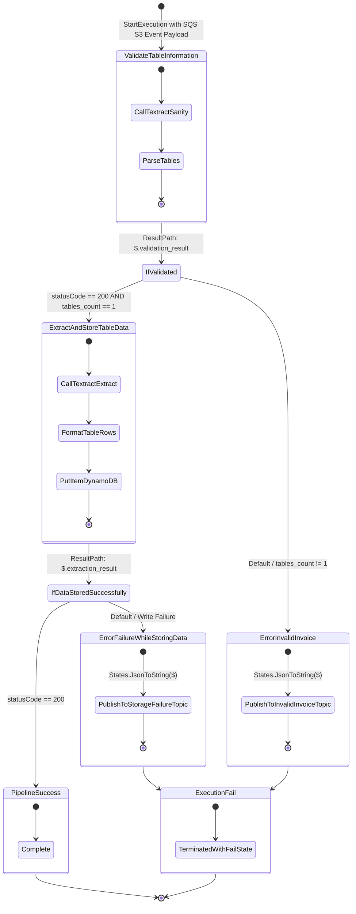

# ⚡ Enterprise Serverless Invoice Processing Pipeline

[](https://aws.amazon.com/serverless/)
[](https://aws.amazon.com/step-functions/)
[](https://aws.amazon.com/textract/)
[](https://www.terraform.io/)
[](https://www.python.org/)
[](https://aws.amazon.com/compliance/)

An enterprise-ready, event-driven serverless pipeline designed to ingest, validate, extract, and persist tabular invoice data from PDF documents using **AWS Step Functions**, **AWS Textract**, **AWS Lambda**, **Amazon SQS**, **Amazon S3**, **Amazon DynamoDB**, and **Amazon SNS**.

The infrastructure provides **100% feature-parity across dual Infrastructure-as-Code (IaC) solutions**: **Terraform** (modularized) and **AWS CloudFormation** (nested/parameterized stacks with automated deployment tooling).

---

## 📑 Table of Contents

- [Architectural Overview](#-architectural-overview)
- [Workflow State Machine](#-workflow-state-machine)
- [Production Hardening & Reliability Features](#-production-hardening--reliability-features)
- [Repository Structure](#-repository-structure)
- [Component Specifications](#-component-specifications)
- [Prerequisites](#-prerequisites)
- [Deployment Option 1: Terraform (Recommended for Multi-Cloud/TF Shops)](#-deployment-option-1-terraform)
- [Deployment Option 2: AWS CloudFormation (Native AWS)](#-deployment-option-2-aws-cloudformation)
- [End-to-End Verification & Testing](#-end-to-end-verification--testing)
- [Operational Runbook & Troubleshooting](#-operational-runbook--troubleshooting)
- [Security & Compliance Matrix](#-security--compliance-matrix)
- [Teardown & Resource Cleanup](#-teardown--resource-cleanup)

---

## 🏗 Architectural Overview

The pipeline employs an asynchronous, decoupled event-driven pattern designed to absorb sudden spikes in invoice uploads while guaranteeing durability and at-least-once processing without dropping events.

```
                                  INVOICE INGESTION & BUFFERING
┌────────────────┐      ObjectCreated      ┌─────────────────────────┐     Poll Batches     ┌────────────────────────┐
│  Client / ERP  │ ──────────────────────► │   Amazon S3 Bucket      │ ───────────────────► │   Amazon SQS Queue     │
│  PDF Upload    │                         │  invoices-<random-id>   │                      │ document-event-queue   │
└────────────────┘                         └─────────────────────────┘                      └───────────┬────────────┘
                                                                                                        │
                                                                                        3 Failures      │ Partial Batch Failures
                                                                                      (Redrive Policy)  │ (ReportBatchItemFailures)
                                                                                                        ▼
                                                                                            ┌────────────────────────┐
                                                                                            │    Amazon SQS DLQ      │
                                                                                            │   document-event-dlq   │
                                                                                            └────────────────────────┘
                                               WORKFLOW ORCHESTRATION
                                                          │
                                                          ▼
                                            ┌───────────────────────────┐
                                            │    AWS Lambda Dispatch    │
                                            │    start-step-function    │
                                            └─────────────┬─────────────┘
                                                          │
                                                          ▼ StartExecution
                                            ┌───────────────────────────┐
                                            │    AWS Step Functions     │
                                            │ InvoiceProcessingWorkflow │
                                            └─────────────┬─────────────┘
                                                          │
                    ┌─────────────────────────────────────┴─────────────────────────────────────┐
                    │                                                                           │
                    ▼ Task: table-sanity-check                                                  │
         ┌─────────────────────┐                                                                │
         │ Validate Structure  │ (Calls AWS Textract: analyze_document)                         │
         └──────────┬──────────┘                                                                │
                    │                                                                           │
                    ▼ Choice: If Validated                                                      │
         ┌─────────────────────┐             Invalid Table Count / Textract Error               │
         │  1 Table Detected?  │ ──────────────────────────────────────────────┐                │
         └──────────┬──────────┘                                               │                │
                    │                                                          ▼                │
                    │ Yes (200 OK)                                   ┌──────────────────┐       │
                    │                                                │ Publish to SNS   │       │
                    ▼ Task: extract-table-data                       │ invalid-invoice- │       │
         ┌─────────────────────┐                                     │ error-topic      │       │
         │ Extract Cells & Rows│ (Calls AWS Textract: analyze_document) └────────┬─────────┘       │
         └──────────┬──────────┘                                               │                │
                    │                                                          ▼                │
                    ▼ Choice: If Data Stored                                 ┌────┐             │
         ┌─────────────────────┐            Database Write Failure           │Fail│             │
         │ DynamoDB Put OK?    │ ──────────────────────────────────────────► └────┘             │
         └──────────┬──────────┘                                               ▲                │
                    │                                                          │                │
                    │ Yes (200 OK)                                   ┌─────────┴────────┐       │
                    │                                                │ Publish to SNS   │       │
                    ▼                                                │ data-storage-    │ ◄─────┘
         ┌─────────────────────┐                                     │ failure-topic    │
         │  Amazon DynamoDB    │                                     └──────────────────┘
         │   invoice-records   │
         │   (TTL: 30 Days)    │
         └─────────────────────┘
```

---

## 🔄 Workflow State Machine

The Step Function state machine preserves context throughout execution by writing intermediate results into discrete keys (`$.validation_result` and `$.extraction_result`), ensuring the original S3 bucket and object references remain accessible to downstream tasks:



---

## 🛡️ Production Hardening & Reliability Features

| Domain | Control | Implementation Details |
| :--- | :--- | :--- |
| **Resilience** | **Partial Batch Failure Handling** | `start-step-function` uses `ReportBatchItemFailures`. Only poison records stay unacknowledged in SQS, while valid records in the same batch proceed. |
| **Resilience** | **Dead-Letter Queue (DLQ)** | Messages failing processing 3 times redrive to `document-event-dlq` with a **14-day** retention period. |
| **Resilience** | **Redrive Allow Policy** | SQS DLQ explicitly restricts redrive sources to `document-event-queue` to prevent unauthorized message injection. |
| **Resilience** | **Step Function Retries** | Automatic retry policies on `Lambda.ServiceException`, `Lambda.AWSLambdaException`, `Lambda.SdkClientException`, and `Lambda.TooManyRequestsException` with exponential backoff and full jitter. |
| **Data Integrity** | **S3 Key URL Decoding** | S3 object keys with spaces, plus signs, and percent-encoded characters (`urllib.parse.unquote_plus`) are accurately resolved, eliminating Textract 404s. |
| **Data Integrity** | **Non-Destructive State** | Tasks specify `ResultPath: $.validation_result` and `ResultPath: $.extraction_result` so the initial S3 metadata is never overwritten. |
| **Security** | **Enforce TLS In-Transit** | Mandatory `Deny` statements for `aws:SecureTransport: "false"` on S3 Buckets, SQS Queues, and SNS Topics. |
| **Security** | **Encryption at Rest** | Default AES256 encryption on S3, SQS-managed server-side encryption (`SqsManagedSseEnabled`), DynamoDB table encryption, and SNS KMS encryption (`alias/aws/sns`). |
| **Security** | **Least-Privilege IAM** | Scoped IAM roles per component. Wildcard `s3:*` is replaced with `s3:GetObject`, `s3:HeadObject`, and `s3:ListBucket`. |
| **Observability** | **Active X-Ray Tracing** | End-to-end distributed tracing enabled across Lambda (`Active` mode) and Step Functions. |
| **Observability** | **CloudWatch Log Management** | Dedicated log groups created with explicit `30-day` retention periods to prevent unmanaged, indefinite storage accumulation. |
| **Durability** | **DynamoDB PITR & TTL** | Point-in-time recovery (PITR) enabled; auto-expiration of processed invoice records configured via `TimeToExist` (30 days). |

---

## 📁 Repository Structure

```
.
├── cloudformation/                         # Production AWS CloudFormation Infrastructure
│   ├── deploy.sh                          # Automated build, package, upload & deployment script
│   ├── parameters-dev.json                # Parameter values for Development stage
│   ├── parameters-prod.json               # Parameter values for Production stage
│   ├── template.yaml                      # Root CloudFormation template (Full serverless pipeline)
│   ├── vpc.yaml                           # Modular VPC & Subnets template (Optional networking)
│   └── README.md                          # Dedicated CloudFormation documentation
├── docs/                                  # Architecture diagrams and documentation assets
│   ├── infra.dot                          # Graphviz infrastructure diagram source
│   └── infra.svg                          # Vector architecture diagram
├── src/                                   # Lambda Function Source Code (Python 3.12)
│   ├── extract_table_data.py              # OCR extraction, row formatting & DynamoDB persistence
│   ├── start_step_function.py             # SQS batch consumer with failure reporting & execution starter
│   └── table_sanity_check.py              # Textract TABLE structural validation
├── terraform/                             # Production Terraform Infrastructure (>= 1.6)
│   ├── files/                             # Lambda zip archives & state machine JSON definition
│   │   ├── extract_table_data.zip
│   │   ├── start_step_function.zip
│   │   ├── step-function-definition.json
│   │   └── table_sanity_check.zip
│   ├── modules/                           # Reusable Terraform Modules
│   │   ├── dynamodb/                      # DynamoDB table module (SSE, PITR, TTL)
│   │   ├── iam/                           # Scoped IAM roles and policies module
│   │   ├── lambda/                        # Lambda module (X-Ray, managed CloudWatch log group)
│   │   ├── s3/                            # S3 module (Public access block, SSE, TLS deny policy)
│   │   ├── sns/                           # SNS module (KMS CMK, TLS deny policy, email subs)
│   │   ├── sqs/                           # SQS module (SSE, DLQ redrive, TLS deny policy)
│   │   ├── step-function/                 # Step Functions state machine (Logging, X-Ray)
│   │   └── vpc/                           # Native AWS VPC, subnets, IGW & routing
│   ├── main.tf                            # Primary Terraform composition
│   ├── outputs.tf                         # Root outputs (ARNs, URLs, Bucket names)
│   ├── provider.tf                        # AWS Provider definition & global tags
│   ├── terraform.tfvars                   # Deployment configuration inputs
│   └── variables.tf                       # Input variable declarations
├── .gitignore                             # Git ignore rules
└── README.md                              # Main enterprise documentation
```

---

## ⚙️ Component Specifications

### 1. Ingestion & Messaging
- **S3 Invoices Bucket**: `invoices-<random-id>` (or custom name). Enforces TLS, server-side encryption, versioning, and public access blocks. Configured with S3 Event Notifications to send `s3:ObjectCreated:*` events to SQS.
- **SQS Document Event Queue**: `document-event-queue`. Visibility timeout set to `180s` (3x Lambda timeout) with a message retention of `4 days` and long polling (`20s`). Configured with `maxReceiveCount = 3` pointing to DLQ.
- **SQS Dead-Letter Queue (DLQ)**: `document-event-dlq`. Message retention set to `14 days`. Protected with an SQS Redrive Allow Policy restricting source queues.

### 2. AWS Lambda Functions (Python 3.12)
| Function Name | Handler | Memory | Timeout | Core Responsibilities |
| :--- | :--- | :--- | :--- | :--- |
| `start-step-function` | `start_step_function.lambda_handler` | `256 MB` | `60s` | Consumes SQS batch; discards `s3:TestEvent` pings; parses S3 metadata; invokes Step Function; returns `batchItemFailures` for unhandled errors. |
| `table-sanity-check` | `table_sanity_check.lambda_handler` | `512 MB` | `60s` | Unquotes S3 keys; verifies object existence; executes Textract `analyze_document` with `FeatureTypes=["TABLES"]`; asserts table count and cell structure. |
| `extract-table-data` | `extract_table_data.lambda_handler` | `512 MB` | `120s` | Extracts cells, headers, and rows from Textract block relationships; persists structured record to DynamoDB with a 30-day epoch TTL. |

### 3. Workflow Orchestration (Step Functions)
- **StateMachine**: `InvoiceProcessingWorkflow`
- **Execution Mode**: `STANDARD`
- **Tracing**: AWS X-Ray Active Tracing enabled
- **Logging**: Level `ALL` sent to `/aws/vendedlogs/states/InvoiceProcessingWorkflow`

### 4. Database & Notifications
- **DynamoDB Table**: `invoice-records`
  - Partition Key: `RecordId` (String, UUIDv4)
  - Sort Key: `filename` (String)
  - Time-To-Live (TTL): Enabled on attribute `TimeToExist`
  - Backup: Point-In-Time Recovery (PITR) enabled
- **SNS Topics**:
  - `invalid-invoice-error-topic`: Notifies operations if an invoice fails table structural checks.
  - `data-storage-failure-topic`: Notifies operations if extraction or DynamoDB writes fail.

---

## 📋 Prerequisites

Before deploying the pipeline, ensure the following tools are installed and configured:

- **AWS CLI** (v2.12+) installed and configured:
  ```bash
  aws configure
  # Verify identity
  aws sts get-caller-identity
  ```
- **Terraform** (v1.6+) or **CloudFormation CLI**
- **Python** (3.10+) with `boto3` and `zip` utility installed:
  ```bash
  python3 --version
  zip --version
  ```

---

## 🚀 Deployment Option 1: Terraform

### Step 1: Package Lambda Source Code
Ensure the Lambda deployment packages in `terraform/files/` are up to date with the latest code from `src/`:

```bash
cd src
zip -q -r ../terraform/files/start_step_function.zip start_step_function.py
zip -q -r ../terraform/files/table_sanity_check.zip table_sanity_check.py
zip -q -r ../terraform/files/extract_table_data.zip extract_table_data.py
cd ..
```

### Step 2: Configure Deployment Variables
Edit `terraform/terraform.tfvars` with your deployment values:

```hcl
region             = "ap-southeast-2"
notification_email = "alerts-team@yourcompany.com"

# Subnet CIDR allocations for optional VPC networking
public_subnets  = ["10.0.1.0/24", "10.0.2.0/24", "10.0.3.0/24"]
private_subnets = ["10.0.4.0/24", "10.0.5.0/24", "10.0.6.0/24"]
azs             = ["ap-southeast-2a", "ap-southeast-2b", "ap-southeast-2c"]
```

### Step 3: Initialize, Plan, and Deploy
```bash
cd terraform

# Initialize providers and local modules
terraform init

# Validate configuration syntax
terraform validate

# Review execution plan
terraform plan -out=tfplan

# Apply the infrastructure
terraform apply tfplan
```

### Step 4: Confirm SNS Email Subscription
AWS will send a subscription confirmation email to the address configured in `notification_email`. **Click the "Confirm subscription" link in your email inbox** to activate failure alert notifications.

---

## 🚀 Deployment Option 2: AWS CloudFormation

The repository provides a complete CloudFormation solution matching all architectural features of the Terraform deployment.

### Method A: Automated Deployment via Shell Script (Recommended)
The automated script creates zip archives, pushes them to an S3 bucket, and deploys the stack in a single step:

```bash
cd cloudformation

# Make script executable
chmod +x deploy.sh

# Run deployment (Creates packages, uploads artifacts, and deploys stack)
./deploy.sh \
  --email "alerts-team@yourcompany.com" \
  --bucket "my-company-deployment-artifacts" \
  --region "ap-southeast-2" \
  --env "prod"
```

### Method B: Manual Deployment via AWS CLI
```bash
# 1. Create a deployment artifact bucket (if not already existing)
aws s3 mb s3://my-company-deployment-artifacts --region ap-southeast-2

# 2. Package and upload Lambda code
cd src
zip -q start_step_function.zip start_step_function.py && aws s3 cp start_step_function.zip s3://my-company-deployment-artifacts/start_step_function.zip
zip -q table_sanity_check.zip table_sanity_check.py && aws s3 cp table_sanity_check.zip s3://my-company-deployment-artifacts/table_sanity_check.zip
zip -q extract_table_data.zip extract_table_data.py && aws s3 cp extract_table_data.zip s3://my-company-deployment-artifacts/extract_table_data.zip
cd ..

# 3. Deploy CloudFormation stack using parameters-prod.json
aws cloudformation deploy \
  --template-file cloudformation/template.yaml \
  --stack-name invoice-processor-prod \
  --parameter-overrides \
      Environment=prod \
      NotificationEmail=alerts-team@yourcompany.com \
      LambdaCodeBucket=my-company-deployment-artifacts \
      StartStepFunctionCodeKey=start_step_function.zip \
      TableSanityCheckCodeKey=table_sanity_check.zip \
      ExtractTableDataCodeKey=extract_table_data.zip \
  --capabilities CAPABILITY_NAMED_IAM \
  --region ap-southeast-2
```

---

## 🧪 End-to-End Verification & Testing

### Test 1: Happy Path (Valid Invoice with Single Table)

1. Obtain the generated invoices bucket name from Terraform or CloudFormation outputs:
   ```bash
   INVOICE_BUCKET=$(terraform -chdir=terraform output -raw invoices_bucket_name)
   echo "Target Bucket: ${INVOICE_BUCKET}"
   ```

2. Upload a valid sample invoice PDF containing tabular rows:
   ```bash
   aws s3 cp sample_invoice.pdf s3://${INVOICE_BUCKET}/sample_invoice.pdf
   ```

3. Monitor the Step Function execution:
   ```bash
   STATE_MACHINE_ARN=$(terraform -chdir=terraform output -raw step_function_arn)

   # List recent executions
   aws stepfunctions list-executions \
     --state-machine-arn "${STATE_MACHINE_ARN}" \
     --max-items 1
   ```

4. Verify table data is saved to DynamoDB:
   ```bash
   DYNAMO_TABLE=$(terraform -chdir=terraform output -raw dynamodb_table_name)

   aws dynamodb scan \
     --table-name "${DYNAMO_TABLE}" \
     --projection-expression "RecordId, filename, processed_time, tables"
   ```

---

### Test 2: Invalid Invoice Handling (No Tables Detected)

1. Upload a plain text document or an image without table data:
   ```bash
   echo "This is not an invoice" > invalid_doc.pdf
   aws s3 cp invalid_doc.pdf s3://${INVOICE_BUCKET}/invalid_doc.pdf
   ```

2. Verify that:
   - The Step Function state machine executes step `Validate Table Information`.
   - The Choice state routes execution to `Error : Invalid invoice`.
   - An email alert is delivered to `notification_email` containing the failure payload.
   - The Step Function enters a `Fail` terminal state (`InvoiceProcessingFailed`).

---

### Test 3: Dead-Letter Queue (DLQ) Resilience

1. Simulate a malformed or poisoned event directly into SQS:
   ```bash
   QUEUE_URL=$(terraform -chdir=terraform output -raw document_event_queue_url)
   DLQ_URL=$(terraform -chdir=terraform output -raw document_event_dlq_url)

   # Send non-S3 corrupt JSON payload
   aws sqs send-message \
     --queue-url "${QUEUE_URL}" \
     --message-body '{"corrupt_payload": true}'
   ```

2. Observe that `start-step-function` logs the parsing error, flags the record in `batchItemFailures`, and allows other records to process normally.
3. After 3 receive attempts, verify the message resides in the DLQ:
   ```bash
   aws sqs receive-message \
     --queue-url "${DLQ_URL}" \
     --attribute-names All
   ```

---

## 📖 Operational Runbook & Troubleshooting

### Diagnostic Commands

#### 1. Inspect Lambda Execution Logs
```bash
# SQS Consumer Dispatcher
aws logs tail /aws/lambda/start-step-function --follow

# Textract Sanity Validator
aws logs tail /aws/lambda/table-sanity-check --follow

# Textract Data Extractor & DynamoDB Store
aws logs tail /aws/lambda/extract-table-data --follow
```

#### 2. Query Step Function Execution History
```bash
# Get details for a specific failed execution
aws stepfunctions get-execution-history \
  --execution-arn "<execution-arn>" \
  --reverse-order \
  --max-items 10
```

#### 3. View SQS Queue & DLQ Metrics
```bash
# Check messages available and messages in flight
aws sqs get-queue-attributes \
  --queue-url "$(terraform -chdir=terraform output -raw document_event_queue_url)" \
  --attribute-names ApproximateNumberOfMessages ApproximateNumberOfMessagesNotVisible

# Check DLQ backlog
aws sqs get-queue-attributes \
  --queue-url "$(terraform -chdir=terraform output -raw document_event_dlq_url)" \
  --attribute-names ApproximateNumberOfMessages
```

### Common Issues & Remediation

| Symptom | Probable Cause | Remediation Step |
| :--- | :--- | :--- |
| **S3 Upload returns `Access Denied`** | Request sent over plain HTTP or public ACL requested. | Ensure upload uses HTTPS (TLS 1.2+). Do not pass public ACL flags (`--acl public-read` is blocked by public access block). |
| **Lambda `Textract.Client.exceptions.InvalidS3ObjectException`** | S3 key containing spaces was not unquoted. | Code utilizes `urllib.parse.unquote_plus(raw_key)`. Verify that the S3 object actually exists in the bucket. |
| **No email alerts received on failure** | SNS subscription remains unconfirmed. | Check email inbox for AWS Notification confirmation email and click "Confirm subscription". |
| **Messages accumulating in DLQ** | Malformed S3 event notifications or Step Function throttling. | Inspect DLQ messages with `aws sqs receive-message`. After addressing the root cause, redrive messages back using AWS Console or CLI Redrive. |

---

## 🔒 Security & Compliance Matrix

| CIS / AWS Well-Architected Requirement | Architectural Implementation | Verification Check |
| :--- | :--- | :--- |
| **SEC-01: Enforce encryption in-transit** | `Deny` policy on all resources where `aws:SecureTransport == false`. | S3, SQS, and SNS reject any non-HTTPS invocation. |
| **SEC-02: Prevent public data exposure** | `aws_s3_bucket_public_access_block` enabled on all buckets. | Public ACLs and bucket policies are blocked. |
| **SEC-03: Enforce encryption at rest** | S3 SSE-AES256, SQS-managed SSE, DynamoDB AWS KMS SSE, SNS KMS master key. | Storage volumes and databases are encrypted at rest. |
| **SEC-04: Least-Privilege IAM Roles** | Unique execution roles per Lambda and Step Function; resource-constrained ARNs. | Roles cannot access resources outside the pipeline. |
| **REL-01: Decouple event ingestion** | S3 writes to SQS rather than invoking Lambda synchronously. | Pipeline tolerates burst traffic without throttling. |
| **REL-02: Dead-letter queue isolation** | SQS DLQ with maximum receive count of 3 and 14-day retention. | Poison pills do not loop indefinitely. |
| **OPS-01: Auditing & Observability** | AWS X-Ray Active Tracing + Step Function execution logging + CloudWatch Logs. | Every step is traceable from ingestion to database write. |
| **COST-01: Lifecycle & Log Retention** | 30-day retention on CloudWatch Log Groups; 30-day TTL on DynamoDB records. | Prevents unbounded growth of stale logs and records. |

---

## 🧹 Teardown & Resource Cleanup

To prevent incurring unnecessary AWS charges, tear down the deployed resources when finished:

### If Deployed via Terraform:
```bash
cd terraform

# Destroy all managed infrastructure
terraform destroy -auto-approve
```

> [!NOTE]
> S3 buckets configured with `force_destroy = true` will empty objects and delete automatically during `terraform destroy`.

### If Deployed via CloudFormation:
```bash
# 1. Empty the invoices S3 bucket first
INVOICES_BUCKET=$(aws cloudformation describe-stacks \
  --stack-name invoice-processor-prod \
  --query "Stacks[0].Outputs[?OutputKey=='InvoicesBucketName'].OutputValue" \
  --output text)

aws s3 rm s3://${INVOICES_BUCKET} --recursive

# 2. Delete the CloudFormation stack
aws cloudformation delete-stack --stack-name invoice-processor-prod

# 3. Wait for deletion to complete
aws cloudformation wait stack-delete-complete --stack-name invoice-processor-prod
```
